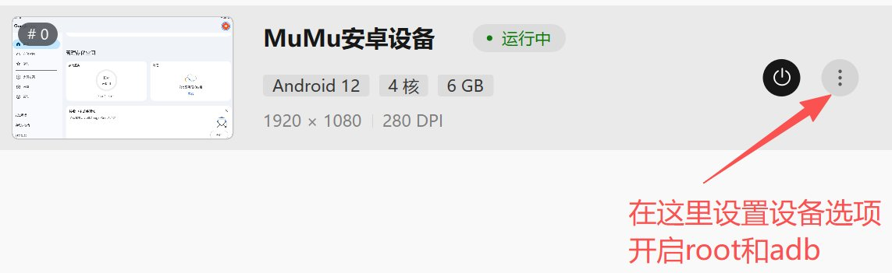
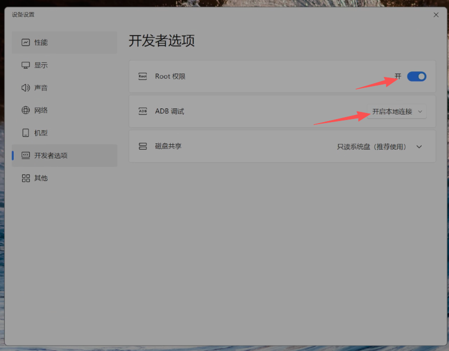
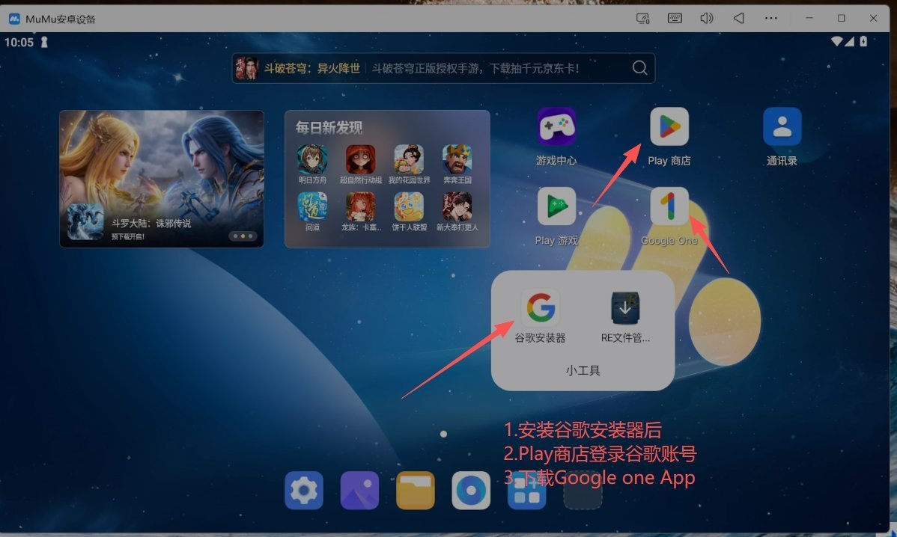

# 安装图解

三步把模拟器准备好。**顺序不能颠倒**：先开 ROOT 和 ADB → 重启模拟器 → 再装 Play 商店。

---

## 图一：开启 MuMu 模拟器的 ROOT 权限



打开 MuMu 模拟器右上角 **☰ 菜单 → 设置 → 其他**，找到 **ROOT 权限**，把它打开。

- 打开后**必须重启模拟器**才生效
- 本工具的 Frida 注入需要 root（`adb root` 能提权即可，不需要额外装面具）

> 没开 ROOT 会报：`❌ 设备没有 root 权限`

---

## 图二：开启 ADB 权限



同一个 **设置** 页面，找到 **ADB 调试**（有的版本叫「ADB 权限」/「USB 调试」），打开。

- 打开后记下模拟器的 **ADB 端口**（MuMu 常见 `7555` / `16384` / `16416`）
- 本工具的脚本默认连 `127.0.0.1:7555`，端口不一样时用 `--serial` 指定：

```bat
python pro0.py --check --serial 127.0.0.1:16384
```

> 没开 ADB 会报：`device not found`

---

## 图三：下载 Google Play 商店 和 Google One



MuMu 自带的应用商店里搜 **Google Play 商店** 安装（有些版本叫「Google 安装器」/「Play 商店」）。

装好 Play 商店后：

1. 打开 **Play 商店**，登录 Google 账号
2. 在 Play 商店里搜 **Google One**（包名 `com.google.android.apps.subscriptions.red`）并安装
3. 打开 Google One → 登录同一个账号 → 进「会员方案」页确认能看到套餐

### 关键：账号必须绑卡

免费试用也要验证付款方式。没绑卡的号点订阅会停在「添加付款方式」页。

Play 商店 → 头像 → **付款和订阅 → 付款方式 → 添加信用卡**

---

## 全部准备好后自检

双击 `一键安装环境.bat`，看到下面全绿就可以开始下单：

```
✅ 设备已连接
✅ frida-server 已启动
✅ 计费模块已就位
✅ Play 商店进程在跑
✅ frida：16.5.9
✅ 环境自检通过，可以开始跑号了
```

---

## 常见问题

| 现象 | 原因 | 解决 |
|---|---|---|
| `❌ 设备没有 root 权限` | 图一的 ROOT 没开或没重启 | 开 ROOT → 重启模拟器 |
| `device not found` | 图二的 ADB 没开 / 端口不对 | 开 ADB，用 `--serial` 指定端口 |
| Play 商店闪退 | 模拟器缺 Google 服务框架 | 用 MuMu 自带的「Google 安装器」装全套 |
| 查询全空（Play 在跑） | 账号卡在验证页 | 在模拟器里完成 Google 账号验证 |
| 收银台一闪就没 | 付款方式被拒 | 换一张卡 |
